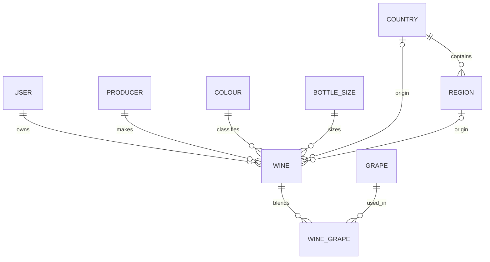

# Spec: Add a wine to my collection

| | |
|---|---|
| **Status** | Draft v2 — assumptions confirmed, ready to implement once sign-in is specified |
| **Last updated** | 2026-10-24 |
| **Depends on** | [Sign in with Google](sign-in-with-google.md) (required) · [View collection](view-collection.md) (draft v1) · [View / edit wine](view-edit-wine.md) (draft v0) |

---

## 1. Purpose

Wine owners lose track of what they have, where it is, and when to drink it. This app is a wine-collection tracker that will be **launched publicly**: anyone with a Google account can use it.

This feature lets a **signed-in collection owner** record a wine they own, so it appears in their collection. It is the first step in building a collection, so it has to be quick to use on a phone, standing at the rack or in a shop.

## 2. Scope

**In scope**
- Manually entering one new wine through a single web form (designed for phones first).
- Validating the input in the browser and on the server.
- Saving the wine to the signed-in owner's collection.
- Creating new shared producers, regions, and grapes as part of saving a wine.
- Blocking duplicates.
- Confirming the save.

**Out of scope**
- Sign-in, sign-out, sessions, creating accounts → *Sign in with Google* spec.
- Listing, searching, or filtering the collection → *View collection* spec.
- Viewing, editing, deleting a wine, or changing its quantity → *View / edit wine* spec.
- Account deletion and data export.
- Barcode or label scanning, photo recognition.
- Lookups in external wine databases.
- Bulk import (CSV).
- Ratings and tasting notes beyond one free-text notes field.
- Tracking consumption ("drank a bottle").
- Valuation and market prices.
- Sharing a collection with other users.
- Offline use or syncing later.
- Fixing or cleaning up shared lookup entries (producers, regions, grapes).
- Languages other than English.

## 3. Users and roles

| Role | Can do |
|---|---|
| Collection owner (signed in with Google) | Add wines to **their own** collection only. Add new shared producers, regions, and grapes while adding a wine. |
| Visitor (not signed in) | Nothing. Opening "Add wine" redirects to Google sign-in, then back to the form. |

Anyone with a Google account can sign up. Each collection is private to its owner.

## 4. User stories

### US-1 — Add a wine (main flow)
*As a collection owner, I want to record a wine I bought, so that my collection is accurate.*
1. The owner taps "Add wine".
2. The system shows the form, with defaults set: quantity 1, bottle size 750 ml, currency EUR.
3. The owner fills in the required fields. Optionally, they open "More details" and fill in the optional fields.
4. Producer, region, and grapes autocomplete from the shared lists. If a value is missing, the owner can choose "Add 'X'".
5. The owner taps "Save wine".
6. The system validates the input and saves the wine. It also saves any new producer, region, or grape the owner entered.
7. The system redirects to the collection list and shows "‹Producer› ‹Name› ‹Vintage› added".

### US-2 — Try to add a duplicate
At step 6, the system finds that the owner already has this wine (BR-6). Nothing is saved. The form stays filled in and shows "You already have this wine (N bottles). **View wine**".

### US-3 — Cancel
The owner taps "Cancel" or navigates away. If any field has been changed, the system asks the owner to confirm discarding the changes. Nothing is saved.

### US-4 — Session expires while filling in the form
At step 5, the session has expired. The system saves the draft in the browser and redirects to Google sign-in. After signing in, the owner is back on the form with every field restored, and can submit again.

## 5. Functional requirements

| ID | Requirement |
|---|---|
| FR-1 | The system shall provide a form for entering a new wine with the fields in §6. |
| FR-2 | The system shall reject a submission that is missing any required field, and identify each missing field. |
| FR-3 | The system shall validate every field against §7 on the server. The browser shall run the same checks so the owner gets early feedback. |
| FR-4 | When a submission is valid, the system shall save the wine linked to the authenticated owner, with a unique ID and timestamps. |
| FR-5 | After saving, the system shall redirect to the collection list and show a confirmation naming the producer, name, and vintage. |
| FR-6 | The system shall block duplicates (BR-6). It saves nothing, shows the existing wine's quantity, and links to the existing wine. |
| FR-7 | The system shall take the owner only from the session, and never save a wine into another user's collection. |
| FR-8 | If saving fails, the system shall keep all of the owner's input in the form. |
| FR-9 | Submitting the same form more than once (for example, a double tap) shall create at most one wine (idempotency key). |
| FR-10 | The API shall apply the same validation to every request, whatever client sent it. |
| FR-11 | The API shall return machine-readable error codes for each field, so the form can show each error next to the right field. |
| FR-12 | The API shall reject any request that changes data if it lacks a valid CSRF token. |
| FR-13 | If the session has expired, the form shall save its contents in the browser before redirecting to sign-in, and restore them afterwards. |
| FR-14 | New producers, regions, and grapes entered with a wine shall be created in the same transaction as the wine (BR-11). Existing ones shall be reused (BR-12). |
| FR-15 | Autocomplete endpoints shall return at most 20 matches, ordered by best match. |
| FR-16 | The API shall enforce the rate limit and the collection size cap (BR-13). |

## 6. Data model

`User` is defined in the *Sign in with Google* spec. Every other entity is defined here.

### Wine
| Field | Type | Required? | Notes |
|---|---|---|---|
| id | UUID | yes (system) | |
| owner_id | FK → User | yes (system) | Taken from the session, never from the request |
| producer_id | FK → Producer | **yes** | |
| name | string (1–200) | **yes** | Name of the specific wine (cuvée), e.g. "Reserva" |
| vintage | smallint | yes, unless the wine is NV | 1800 – current year |
| is_non_vintage | boolean | yes | Default `false`. When `true`, `vintage` must be null |
| colour_id | FK → Colour | **yes** | |
| bottle_size_id | FK → BottleSize | **yes** | Default 750 ml |
| quantity | integer | **yes** | 1–9 999, default 1 |
| country_id | FK → Country | no | |
| region_id | FK → Region | no | Must belong to `country_id` (BR-9) |
| purchase_price | decimal(10,2) | no | Price per bottle |
| currency | char(3), ISO 4217 | if a price is given | Default `EUR` |
| purchase_date | date | no | |
| storage_location | string (≤100) | no | e.g. "Rack B, shelf 2" |
| drink_from | smallint (year) | no | |
| drink_until | smallint (year) | no | |
| notes | text (≤2 000) | no | |
| created_at / updated_at | timestamp | yes (system) | |

### Producer (shared by all users; users can add)
| Field | Type | Required? | Notes |
|---|---|---|---|
| id | UUID | yes | |
| name | string (1–200) | yes | |
| country_id | FK → Country | no | |
| region_id | FK → Region | no | |
| created_by | FK → User | yes (system) | |
| is_public | boolean | yes (system) | Default `false`; see BR-14 |

Unique: (case-insensitive trimmed name, country_id).

### Region (shared by all users; users can add)
| Field | Type | Required? | Notes |
|---|---|---|---|
| id | UUID | yes | |
| country_id | FK → Country | **yes** | |
| name | string (1–100) | yes | e.g. "Douro" |
| created_by | FK → User | no | Null for seeded rows |
| is_public | boolean | yes (system) | `true` for seeded rows; see BR-14 |

Unique: (country_id, case-insensitive trimmed name). Seeded from the sources in §11.

### Grape (shared by all users; users can add)
| Field | Type | Required? | Notes |
|---|---|---|---|
| id | UUID | yes | |
| name | string (1–100) | yes | Unique, case-insensitive |
| created_by | FK → User | no | Null for seeded rows |
| is_public | boolean | yes (system) | `true` for seeded rows; see BR-14 |

Seeded from the sources in §11.

### WineGrape (join table)
| Field | Type | Required? | Notes |
|---|---|---|---|
| wine_id | FK → Wine | yes | PK part |
| grape_id | FK → Grape | yes | PK part |
| percentage | smallint (1–100) | no | |

### Colour (system-managed, read-only)
| Field | Type | Required? | Notes |
|---|---|---|---|
| id | smallint | yes | |
| code | string | yes, unique | `red`, `white`, `rose`, `sparkling`, `fortified`, `dessert`, `orange` |
| name | string | yes | English display name |

### Country (system-managed, read-only)
| Field | Type | Required? | Notes |
|---|---|---|---|
| id | smallint | yes | |
| iso_code | char(2) | yes, unique | ISO 3166-1 alpha-2 |
| name | string | yes | English name |

Seeded with the full ISO 3166-1 list.

### BottleSize (system-managed, read-only)
| Field | Type | Required? | Notes |
|---|---|---|---|
| id | smallint | yes | |
| volume_ml | integer | yes, unique | |
| name | string | yes | |

Seed: 187 Piccolo · 375 Half · 500 · 750 Standard · 1500 Magnum · 3000 Double magnum · 6000 Imperial.

### Relationships



## 7. Business rules and validation

| ID | Rule |
|---|---|
| BR-1 | `name` and the producer name are 1–200 characters after trimming. Leading and trailing whitespace is removed before saving. |
| BR-2 | A wine has **either** `vintage` between 1800 and the current year **or** `is_non_vintage = true`. It never has both, and never neither. |
| BR-3 | `quantity` is a whole number from 1 to 9 999. |
| BR-4 | `colour_id`, `bottle_size_id`, and `country_id` must reference existing rows. Users cannot add colours, bottle sizes, or countries. |
| BR-5 | `purchase_price` is ≥ 0 with at most 2 decimals. `currency` is a valid ISO 4217 code, required when a price is given, and defaults to EUR. `purchase_date` is not in the future. |
| BR-6 | **Duplicate:** the same owner already has a wine with the same producer, the same name (case-insensitive, trimmed), the same vintage, and the same bottle size. Two NV wines count as having the same vintage. Duplicates are **blocked**. |
| BR-7 | `drink_from` ≤ `drink_until` when both are given. If the wine has a vintage, `drink_from` ≥ `vintage`. |
| BR-8 | `notes` ≤ 2 000 characters; `storage_location` ≤ 100 characters. |
| BR-9 | If `region_id` is given, the region must belong to `country_id`. If a region is given without a country, the country is set from the region. |
| BR-10 | The grapes on one wine are distinct. Each `percentage` is 1–100, and the percentages add up to ≤ 100. |
| BR-11 | New producers, regions, and grapes are created only as part of saving a wine, in the same transaction. If the wine is not saved, none of them are created. |
| BR-12 | A typed producer, region, or grape that matches an existing one (case-insensitive, trimmed) reuses that row. These lists are **shared by all users**. |
| BR-13 | Each user may make at most 60 add-wine requests per minute. Each collection holds at most 10 000 wine **records**; bottle quantities do not count toward the limit. |
| BR-14 | **Private until shared:** a producer, region, or grape created by a user starts with `is_public = false`, and only that user sees it in autocomplete. It becomes public when a **second, different user** saves a wine that uses it — including by typing a matching name (BR-12). Seeded rows are public from the start. Once public, an entry never becomes private again. |

## 8. Interfaces

### Screen: Add wine (web, designed for phones first)
- **Entry:** an "Add wine" button on the collection list (the home screen).
- **Layout:** one column at every screen width, at most about 640 px wide.
- **Always visible (required fields):**
  - Producer (autocomplete with an "Add 'X'" option)
  - Name
  - Vintage (number) with an "NV" checkbox
  - Colour (select)
  - Bottle size (select)
  - Quantity (number)
- **"More details" (collapsed by default; opens automatically if any field inside it has an error):**
  - Country (select)
  - Region (autocomplete, filtered by country)
  - Grapes (multi-value autocomplete, each with an optional percentage)
  - Price, and currency (select, defaults to EUR)
  - Purchase date (date picker)
  - Storage location
  - Drink from / until (years)
  - Notes
- **Phone keyboards:** numeric keypad for vintage, quantity, and years. Decimal keypad for price.
- **Actions:**
  - *Save wine* — the primary button, fixed at the bottom of the screen on phones.
  - *Cancel* — the secondary button.
- **Errors:**
  - Each error appears under its field.
  - A summary at the top lists all errors.
  - Focus moves to the first invalid field.
- **Duplicate:** an inline notice says "You already have this wine (N bottles). **View wine**".
- **Success:** redirect to the collection list with the message "‹Producer› ‹Name› ‹Vintage› added".
- **Language:** English. All UI text is kept in one place so it can be translated later.

### API (same domain, under `/api/v1`, session cookie + CSRF header)

**`POST /api/v1/collection/wines`**

Headers: `X-CSRF-Token`, `Idempotency-Key`, `Content-Type: application/json`

```json
{
  "producer": { "id": "8b1e…" },
  "name": "Reserva",
  "vintage": 2017,
  "is_non_vintage": false,
  "colour_id": 1,
  "bottle_size_id": 4,
  "quantity": 3,
  "country_id": 177,
  "region": { "name": "Douro" },
  "grapes": [
    { "grape": { "name": "Touriga Nacional" }, "percentage": 60 },
    { "grape": { "id": "c41f…" } }
  ],
  "purchase_price": 24.50,
  "currency": "EUR",
  "purchase_date": "2026-10-01",
  "storage_location": "Rack B, shelf 2",
  "drink_from": 2024,
  "drink_until": 2032,
  "notes": "Gift from Ana"
}
```

Producer, region, and each grape are sent as `{ "id": … }` to use an existing row, or `{ "name": … }` to create a new one. Unknown fields are rejected, and so are system fields (`id`, `owner_id`, timestamps).

| Status | When | Body |
|---|---|---|
| 201 | Saved | The saved wine. Header `Location: /api/v1/collection/wines/{id}` |
| 400 | Invalid input | `{ "errors": [ { "field": "vintage", "code": "out_of_range", "message": "…" } ] }` |
| 401 | No valid session | `{ "code": "unauthenticated" }` |
| 403 | CSRF token missing or invalid | `{ "code": "csrf" }` |
| 409 | Duplicate | `{ "code": "duplicate", "existing_id": "…", "existing_quantity": 2 }` |
| 422 | Collection is full | `{ "code": "collection_limit" }` |
| 429 | Rate limit exceeded | `{ "code": "rate_limited" }` + `Retry-After` header |
| 500 / 503 | Server failure | `{ "code": "server_error" }` — no internal details |

**Lookup endpoints (read-only, signed-in users only)**

| Endpoint | Returns |
|---|---|
| `GET /api/v1/colours` | All colours |
| `GET /api/v1/bottle-sizes` | All bottle sizes |
| `GET /api/v1/countries` | All countries |
| `GET /api/v1/regions?country={iso}&q={text}` | ≤ 20 matching regions |
| `GET /api/v1/producers?q={text}` | ≤ 20 matching producers |
| `GET /api/v1/grapes?q={text}` | ≤ 20 matching grapes |

The producer, region, and grape endpoints return public entries plus the requesting user's own private entries — never another user's private entries (BR-14).

## 9. Error handling and edge cases

| Situation | Behaviour |
|---|---|
| Required field missing or invalid | Nothing saved. Errors shown next to each field and in the summary. Input kept. |
| Both a vintage and NV, or neither | Error on the vintage field. |
| Region does not match the country | Error on the region field. |
| Grape percentages add up to more than 100 | Error on the grapes field. |
| Duplicate wine, including NV | Nothing saved. Duplicate notice with the existing quantity and a "View wine" link. |
| Typed producer, region, or grape already exists (any case) | The existing row is reused; no copy is created. |
| Saving the wine fails after a new lookup value was typed | Nothing is saved: neither the wine nor the new lookup row. |
| Double tap or repeated submit | Exactly one wine is created (idempotency key). |
| Session expired | Draft saved in the browser, redirect to Google sign-in, form restored afterwards. |
| User cancels Google sign-in | Back to the form with the draft kept and the message "Sign in to save this wine". |
| No network | "You're offline. Your wine wasn't saved." Input kept. Nothing queued. |
| Rate limit (429) | "Too many requests. Wait a moment and try again." Input kept. |
| Collection is full (422) | "Your collection has reached 10,000 wines." Input kept. |
| Server error | "Couldn't save your wine. Try again." Input kept. |
| Unicode text (Château, 酒) | Accepted and stored as entered. |
| HTML or script in text fields | Stored as plain text; escaped when displayed. |
| Leaving the page with unsaved changes | Asks the user to confirm. |

## 10. Non-functional requirements

- **Performance:** a save completes in under 1 s at p95. Autocomplete responds in under 300 ms at p95. The first page load is under 200 KB compressed.
- **Security:**
  - Session cookie is `HttpOnly`, `Secure`, `SameSite=Lax`.
  - CSRF token required on every request that changes data.
  - The server also checks the `Origin` header.
  - All validation happens on the server.
  - The owner is always taken from the session.
  - No CORS headers (same domain).
  - HTTPS only.
- **Privacy:**
  - A collection is visible only to its owner.
  - Producers, regions, and grapes that a user creates stay private to that user until a second user uses them (BR-14).
  - Shared entries never show who added them.
- **Legal (public launch):**
  - A privacy notice and terms of use must be published before launch.
  - Data handling must comply with the applicable data-protection law (for example, GDPR when serving EU users).
- **Accessibility:** WCAG 2.1 AA:
  - Every field has a label.
  - Errors are linked to their fields via `aria-describedby` and announced to screen readers.
  - The form works with the keyboard alone.
  - Touch targets are ≥ 44 × 44 px.
- **Platforms:**
  - Phone browsers: Safari on iOS and Chrome on Android, current and previous major version.
  - Desktop browsers: current Chrome, Firefox, Safari, and Edge.
  - Usable from a screen width of 360 px.
- **Internationalisation:** English only. UI text is kept in one place so it can be translated later. Currency is chosen per wine, with EUR as the default.
- **Availability:** online only. No offline support.

## 11. Dependencies and constraints

**Specs this depends on**

| Spec | Needed for | Status | Fallback until it exists |
|---|---|---|---|
| Sign in with Google | Any access | Draft v1 (reviewed) | None — this one is required |
| [View collection](view-collection.md) | Redirect after saving | Draft v1 | A confirmation page with an "Add another" button |
| [View / edit wine](view-edit-wine.md) | The "View wine" link in the duplicate notice; adding bottles to a wine you already have | Draft v0 | The duplicate notice without the link |

**External services:** Google Identity (OpenID Connect) — an OAuth client and consent screen, scopes `openid email profile`. Because this is a public launch, the consent screen must be in "In production" status, with the app name, logo, and privacy notice link verified by Google.

**Seed data sources**

| List | Source | Bar for launch |
|---|---|---|
| Grapes | [VIVC](https://www.vivc.de) (Vitis International Variety Catalogue) — the ~300 most-planted varieties | The main grapes of the top 10 wine-producing countries autocomplete |
| Regions | The EU's eAmbrosia register of protected wine names (EU countries), plus a hand-made list of major regions elsewhere (e.g. Napa, Barossa, Mendoza) | The major regions of the top 10 wine-producing countries autocomplete |
| Countries | ISO 3166-1 | Complete |
| Colours, bottle sizes | Defined in §6 | Complete |

**Before launch:** a privacy notice and terms of use; and confirmation that VIVC's terms of use allow its data to be reused in a public app (see OQ-4).

**Stack**

| Layer | Choice |
|---|---|
| Language | TypeScript, front end and back end; validation rules shared between them |
| Web app | React single-page app built with Vite, designed for phones first |
| API | Node.js + Fastify, JSON REST under `/api/v1` |
| Database | PostgreSQL |
| Auth | Google OIDC, sessions stored on the server in PostgreSQL |
| Testing | Vitest (rules, API) and Playwright (acceptance criteria, at phone and desktop sizes) |
| Hosting | One HTTPS domain; a reverse proxy sends `/api` to the API and everything else to the web app |

**Deadline:** none.

## 12. Acceptance criteria

| ID | Given | When | Then |
|---|---|---|---|
| AC-1 | I am signed in | I submit producer "Quinta do Crasto", name "Reserva", vintage 2017, colour red, quantity 3 | The wine is saved with quantity 3 and bottle size 750 ml |
| AC-2 | The producer field is empty | I submit | Nothing is saved and the producer field shows "Producer is required" |
| AC-3 | I enter vintage 2099 | I submit | Nothing is saved and the vintage field shows an error |
| AC-4 | I enter quantity 0, or 2.5 | I submit | Nothing is saved and the quantity field shows an error |
| AC-5 | I own "Quinta do Crasto / Reserva / 2017 / 750 ml" | I add "QUINTA DO CRASTO / reserva / 2017 / 750 ml" | The duplicate notice appears, nothing is saved, and my existing quantity is unchanged |
| AC-6 | I own "Krug / Grande Cuvée / NV / 750 ml" | I add the same wine as NV again | It is blocked as a duplicate |
| AC-7 | I am not signed in | I call `POST /api/v1/collection/wines` | I get 401 and nothing is saved |
| AC-8 | A request body includes `owner_id` | It is submitted | I get 400 and nothing is saved |
| AC-9 | Saving fails on the server | The error appears | Every value I entered is still in the form |
| AC-10 | I submit twice with the same `Idempotency-Key` | — | Exactly one wine exists |
| AC-11 | I use only the keyboard and a screen reader | I fill in and submit the form with errors | I can reach every control, and the errors are announced |
| AC-12 | A 360 px-wide screen | I open "Add wine" | Every field and button can be reached without scrolling sideways |
| AC-13 | A phone | I tap the vintage field | A numeric keyboard appears |
| AC-14 | A valid session cookie but no CSRF token | I submit | I get 403 and nothing is saved |
| AC-15 | My session expired while I was filling in the form | I sign in with Google again | I'm back on "Add wine" with every field restored |
| AC-16 | I made 60 add-wine requests in the last minute | I submit another | I get 429 and nothing is saved |
| AC-17 | I type a new grape "Tinta Roriz" | I save, and saving the wine fails | Neither the wine nor the grape is created |
| AC-18 | I pick region "Douro" and country "France" | I submit | Nothing is saved and the region field shows an error |
| AC-19 | Producer "Quinta do Crasto" exists | I type "quinta do crasto" and save | The existing producer is reused and no new producer row is created |
| AC-20 | I open the form | — | Quantity is 1, bottle size 750 ml, currency EUR, and all text is in English |
| AC-21 | My collection has 10 000 wines | I submit a valid new wine | I get 422 and see the "collection limit" message |
| AC-22 *(requires View collection)* | I save a valid wine | — | I land on the collection list and see "Quinta do Crasto Reserva 2017 added" |
| AC-23 *(requires View / edit wine)* | I get the duplicate notice | I tap "View wine" | The existing wine opens |
| AC-24 | User A created producer "Quinta Nova X" and no one else has used it | User B types "Quinta" in the producer field | "Quinta Nova X" is not suggested to user B |
| AC-25 | User A created producer "Quinta Nova X" | User B types "quinta nova x" and saves a wine | B's wine uses A's producer row, the producer becomes public, and it is now suggested to everyone |
| AC-26 | "More details" is collapsed and the purchase date is in the future | I submit | "More details" opens and the purchase date field shows an error |

AC-22 and AC-23 are tagged *requires dependency*. Until those specs are delivered, they don't block "done" for this feature (see the fallbacks in §11).

## 13. Open questions and assumptions

### Assumptions
All assumptions from v1 (A1–A6) are now confirmed and recorded in the decision log below. There are no open assumptions.

### Open questions
| ID | Question |
|---|---|
| OQ-4 | Do VIVC's terms of use allow its data to be reused in a public app? If not, the grape list must be compiled from another source or by hand. |
| OQ-5 | Who writes the privacy notice and terms of use, and in which jurisdiction does the app operate? This decides which data-protection law applies. |
| OQ-6 | Later: an admin tool to merge or fix shared entries that became public (out of scope here; BR-14 limits the damage until then). |

### Decision log
| # | Question | Decision |
|---|---|---|
| Q3 | Platform | Web form |
| Q3a | Same app or separate API | Separate API |
| Q3b | Phone use | Phone browser is a main target |
| Q3c | Offline | Not needed |
| Q4/Q5 | Stack / deadline | Stack chosen in §11; no deadline |
| Q6 | One bottle or one wine with a quantity | One wine with a quantity |
| Q7 | Field list | Accepted as in §6 |
| Q8 | Free text or lists | Separate tables for producer, colour, country, region, grapes, bottle size |
| Q9 | Non-vintage wines | Supported (`is_non_vintage`) |
| Q10 | Duplicates | Blocked |
| Q11 | After saving | Go to the collection list (home) |
| Q12 | Currency | EUR by default |
| Q13 | Language | English by default |
| Q14 | Sign-in | Google account, session cookie |
| Q15 | Domains | Web app and API on the same domain |
| Q16 | Sign-in exists already? | No — separate spec, required first |
| Q17 | Session length | 30 days, rolling |
| Q18 | Who can sign up | Anyone |
| Q19 | Lookup lists | Shared by all users |
| Q20 | Link from the duplicate notice | Yes, to the existing wine |
| Q21 | Home screen | The collection list |
| Q22 | Vintage | A number on the wine, not a table |
| A1 | Performance targets | Confirmed: save < 1 s p95, autocomplete < 300 ms p95, first load < 200 KB |
| A2 | Rate limit | Confirmed: 60 add-wine requests per minute per user |
| A3 | Collection cap | Confirmed: 10 000 wine records; quantities don't count (BR-13) |
| A4 | Fallbacks for missing screens | Confirmed as in §11 |
| A5 | Optional fields | Confirmed: collapsed under "More details", opening automatically on error |
| A6 | Sharing collections | Confirmed: collections are private, no sharing |
| OQ-1 | Seed sources | VIVC for grapes; eAmbrosia plus a hand-made list for regions (§11) |
| OQ-2 | Typos in shared lists | Private until a second user uses the entry (BR-14) |
| OQ-3 | What the app is | A wine-collection tracker to be launched publicly |
